# Alto Bank

A full-stack online banking app built with **ASP.NET Core MVC (.NET 8)**, **Entity Framework Core** on SQLite, and Bootstrap 5.
Customers manage accounts, move money, pay bills, send money to each other and track their spending; staff run the bank from a
separate admin console where every action is audited.

Built by **Austin Emig** for **Server Sided Web Development**.

> **Class project.** Alto Bank is fictional: no real money, no real customers, not a real bank. All data is generated demo data.

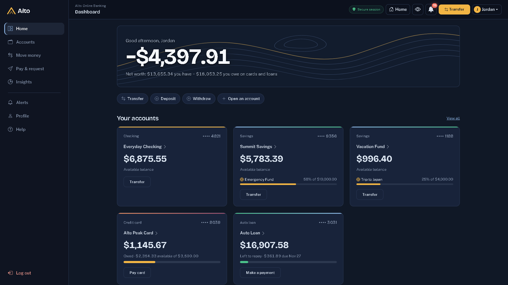

## What it does

**For customers** (`/dashboard`)

- **Accounts:** checking and savings with savings goals, account details with searchable activity, monthly statements, a direct
  deposit form and a virtual debit card. New accounts go through a 7-step application with a simulated identity check.
- **Move money:** transfers between your own accounts, deposits and withdrawals, with a daily transfer limit and frozen/closed
  account rules enforced on the server.
- **Send & request:** pay another Alto customer by email or phone (with a "Sending to Maya C." preview), request money, split a
  bill evenly or by custom amounts, and pay or decline requests. Requests expire after 14 days.
- **Bill Pay and Upcoming:** manage payees, pay now, on a date, weekly or monthly, and schedule transfers between your own
  accounts. A calendar shows everything that's coming up; skip, edit or cancel any item.
- **Insights and Budgets:** every transaction is categorized automatically (and you can change it). A monthly view shows spending
  by category, month over month, top merchants and plain-language callouts. Monthly budgets turn amber at 75% and red at 100%,
  with an alert at each.
- **Alerts and Profile:** a notification bell, plus settings for personal info, password and sign-ins, which alerts to get,
  low-balance and large-purchase alerts, privacy mode, a default account and color themes.

**For staff** (`/admin`)

- A console with a work queue, customer search and a status bar (scheduler health, pending applications, frozen accounts).
- Customers, accounts, transactions, applications, P2P payments and scheduled payments, with filters.
- Actions such as freezing an account, adjustments and reversals need a written reason and run in a database transaction that
  writes an audit log entry. Staff can't use admin tools on their own accounts.
- An **Owner** role (set in configuration, never from the website) adds and removes admins.

## Screenshots

| | |
|---|---|
| 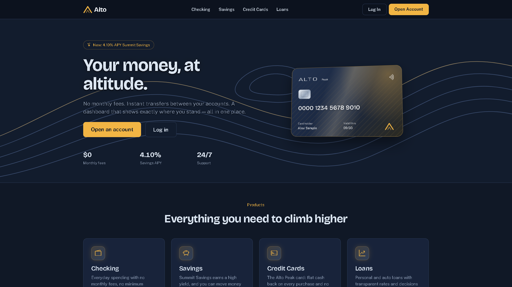 Public home page | 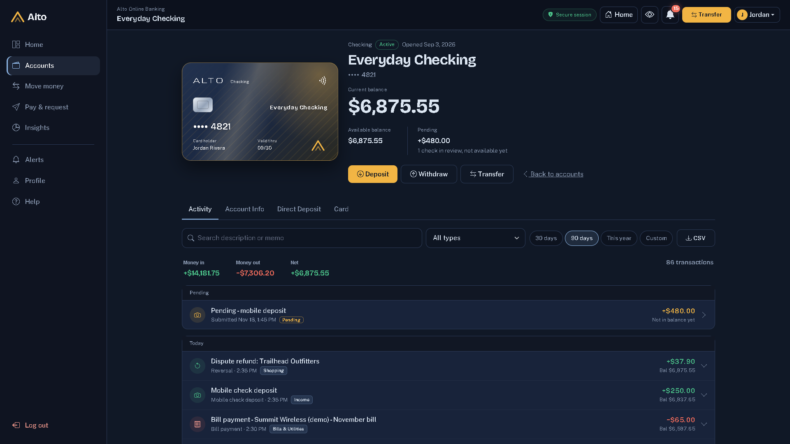 Account details |
| 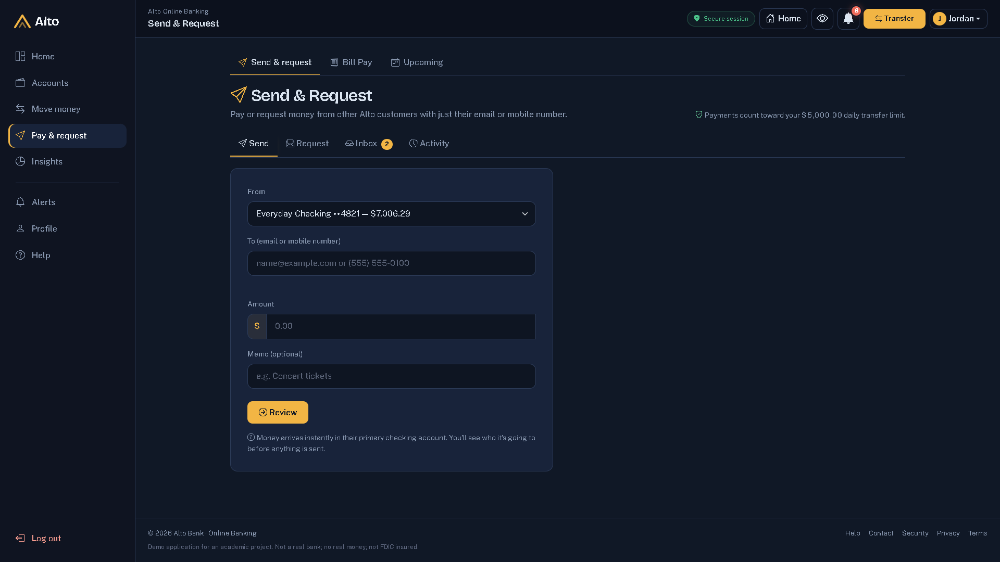 Send & request | 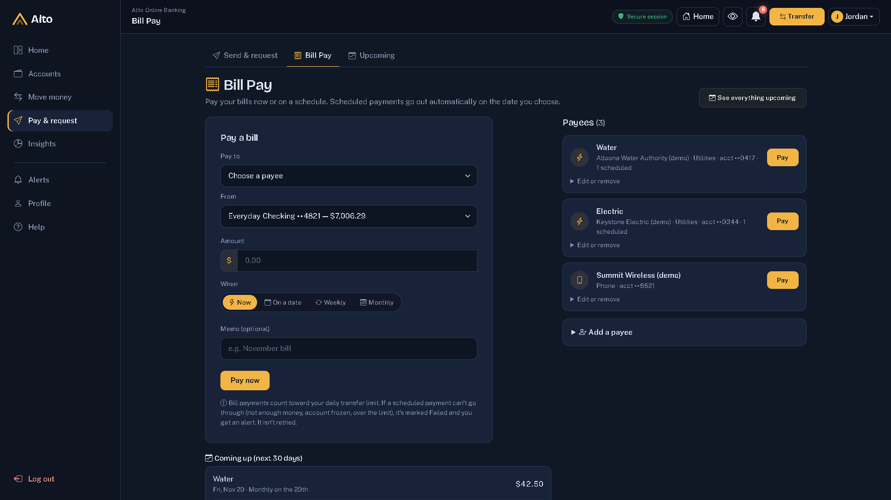 Bill Pay |
| 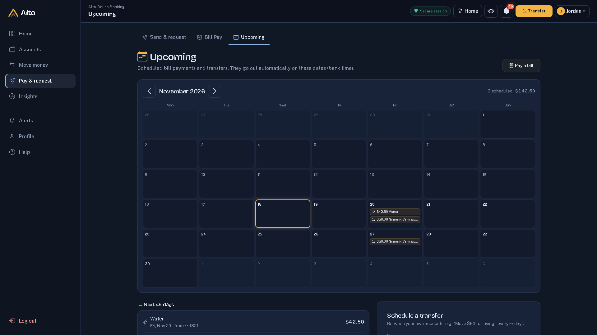 Upcoming calendar | 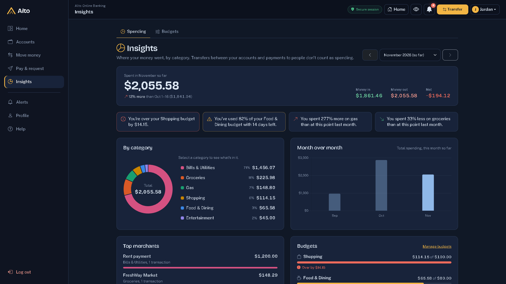 Spending insights |
| 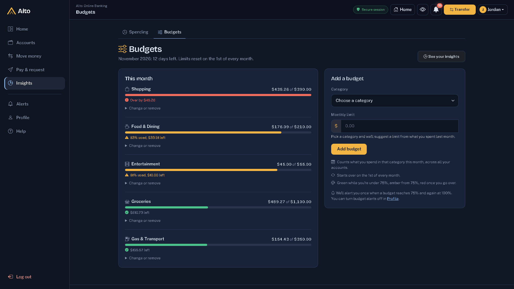 Budgets | 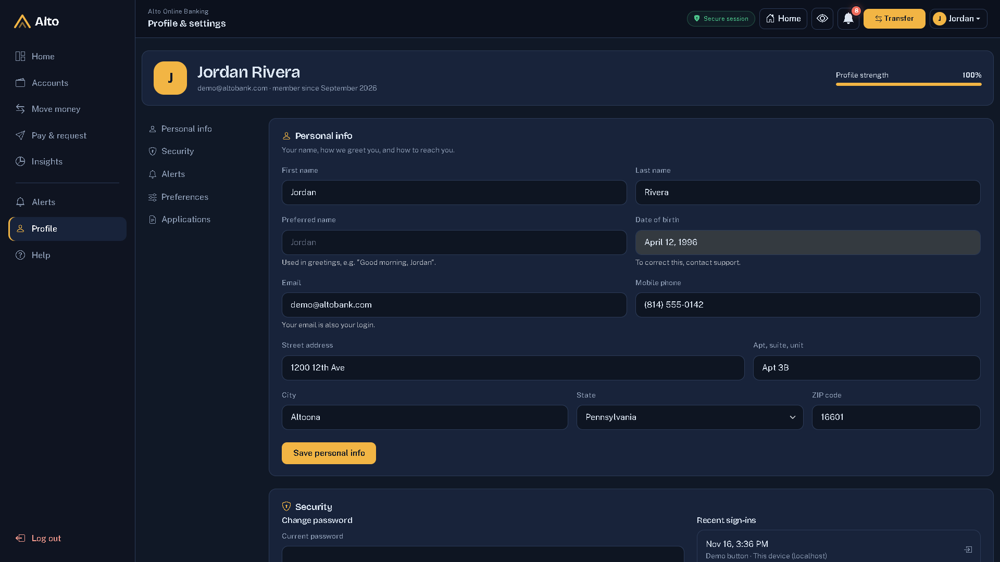 Profile & settings |
| 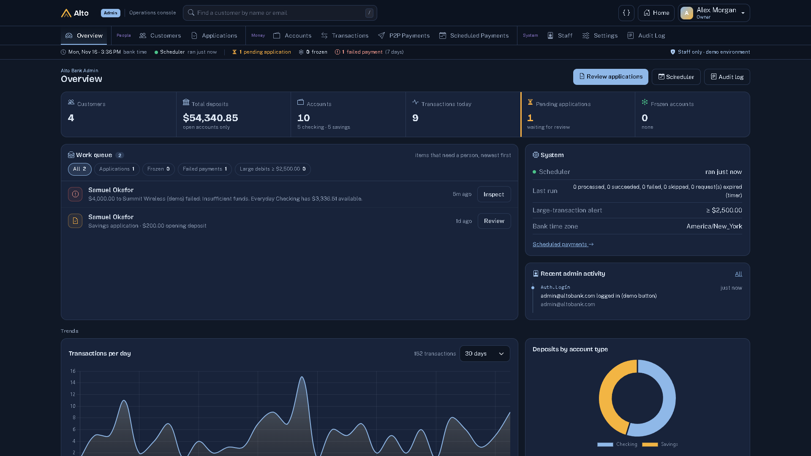 Admin console | 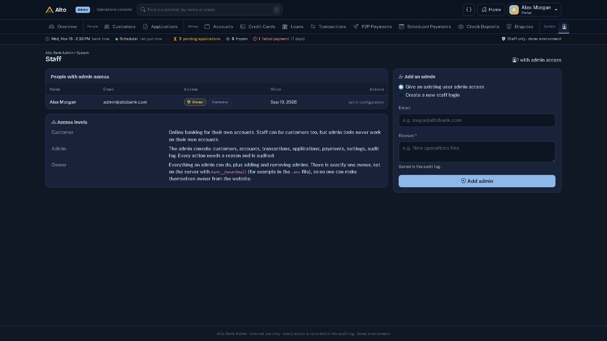 Staff (Owner only) |

On a phone:

<p>
  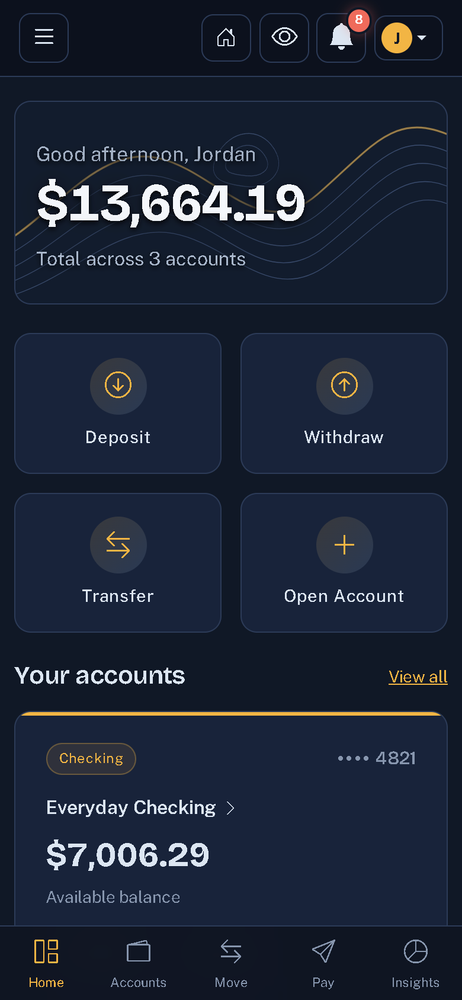
  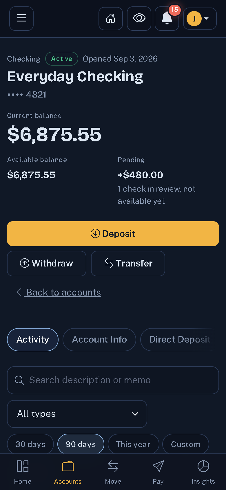
  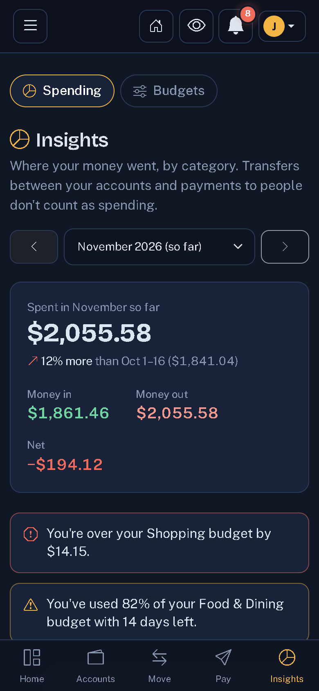
  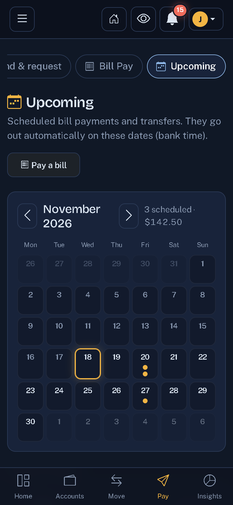
</p>

## How it's built

| Area | Approach |
|---|---|
| Web | ASP.NET Core MVC with Razor views, an `Admin` area, tag helpers (`<money>`), view components and shared partials |
| Data | EF Core 8 with SQLite (WAL mode and a busy timeout), code-first migrations, enums stored as text |
| Auth | ASP.NET Core Identity with Customer, Admin and Owner roles; antiforgery tokens on every form |
| Money rules | All customer money movement goes through one service (`IBankService`). Each movement runs in a single database transaction, and `Account.Balance` is a concurrency token, so two requests racing on one account can't overdraw it |
| Records | Nothing is deleted: transactions are reversed with an offsetting entry, and accounts, payees and budgets are closed or removed by status |
| Background work | A `BackgroundService` scheduler pays bills and scheduled transfers and expires old requests. A unique index on (item, date) means a payment can never run twice for the same date, even after a restart |
| Time | Times are stored in UTC; "today", months and the daily limit follow the bank's time zone (America/New_York) |
| API | A JSON API (`/api/accounts`, `/api/payments`, `/api/insights`) that returns DTOs, never entities. The charts read from it. Swagger docs at `/swagger` in Development |
| Front end | Bootstrap 5, Chart.js and small vanilla JavaScript modules; responsive down to phone width |

```
AltoBank/
  Controllers/        customer pages + Controllers/Api (JSON API)
  Areas/Admin/        the admin console (controllers, views, IAdminService)
  Services/           IBankService (money), scheduling, alerts, insights, budgets, payments, cards
  Models/ Data/       EF Core entities, DbContext, seed data
  Migrations/         EF Core migrations
  Views/ wwwroot/     Razor views, CSS and JavaScript
tests/                end-to-end test suites (bash + curl) and a small SQL helper
docs/                 requirements map and screenshots
```

## Run it

You need the [.NET 8 SDK](https://dotnet.microsoft.com/download/dotnet/8.0) (`dotnet --list-sdks` to check).

```bash
cd AltoBank
dotnet tool restore
dotnet run
```

Open **http://localhost:5264**. The SQLite database (`altobank.db`) is created and filled with demo data the first time it runs.

### Demo logins

On the login page, click **Demo Customer** or **Demo Admin**, or sign in with:

| Who | Email | Password |
|---|---|---|
| Customer (Jordan) | demo@altobank.com | Demo123! |
| Customer (Maya) | maya@altobank.com | Demo123! |
| Customer (Sam) | sam@altobank.com | Demo123! |
| Admin and Owner (Alex) | admin@altobank.com | Admin123! |

These are made-up demo accounts. The admin also has customer accounts of their own.

### Optional settings

Copy `AltoBank/.env.example` to `AltoBank/.env` (git-ignored) to make someone else the Owner. If you don't, the demo admin is
the Owner.

### Reset the demo data

```bash
cd AltoBank
dotnet run -- --seed       # add any missing demo data, then exit (safe to run again)
dotnet run -- --reset-db   # delete the database and start over with fresh demo data, then exit
```

## Tests

`tests/` holds 12 end-to-end suites (822 checks) that drive the running app over HTTP: money rules, races, ownership checks
(another customer's id returns 404), antiforgery, the scheduler, P2P, Bill Pay, staff permissions, profile settings, insights
and budgets. Run them against a **separate test server with its own scratch database**, never your real `altobank.db`:

```powershell
# terminal 1: a test server on a scratch database
cd AltoBank
$env:ConnectionStrings__DefaultConnection = "Data Source=C:\temp\alto-test.db"
dotnet run -- --reset-db
$env:ASPNETCORE_URLS = "http://localhost:5299"; $env:Scheduler__IntervalSeconds = "5"
dotnet run --no-launch-profile
```

```bash
# terminal 2
B=http://localhost:5299 TEST_DB="C:/temp/alto-test.db" bash tests/run_all.sh
```

Each suite's log is saved to `test-logs/`.

## More detail

[docs/REQUIREMENTS.md](docs/REQUIREMENTS.md) maps each course requirement (EF Core loading strategies, model binding,
validation, tag helpers, areas, the API and more) to the code that uses it.

## Roadmap

Mobile check deposit (image upload with an admin review queue) and transaction disputes are planned next.
